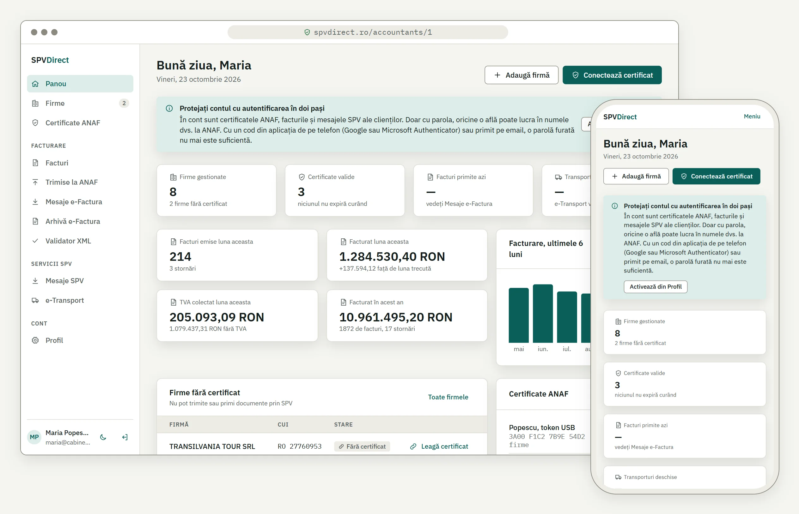
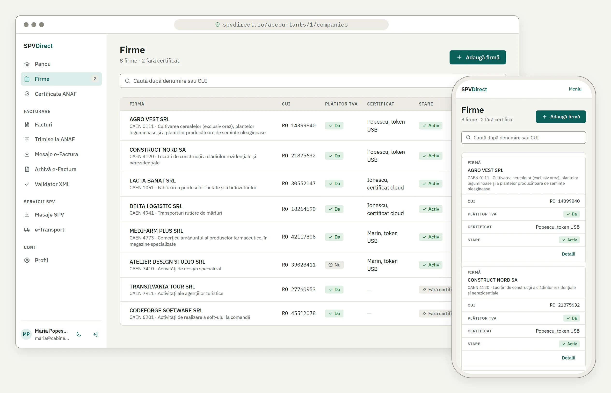
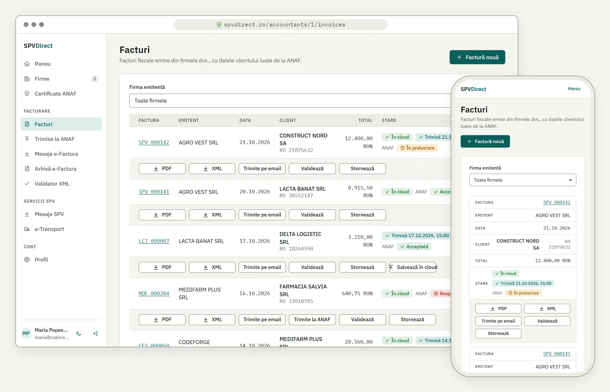
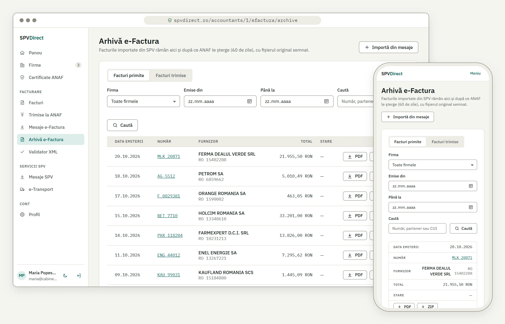
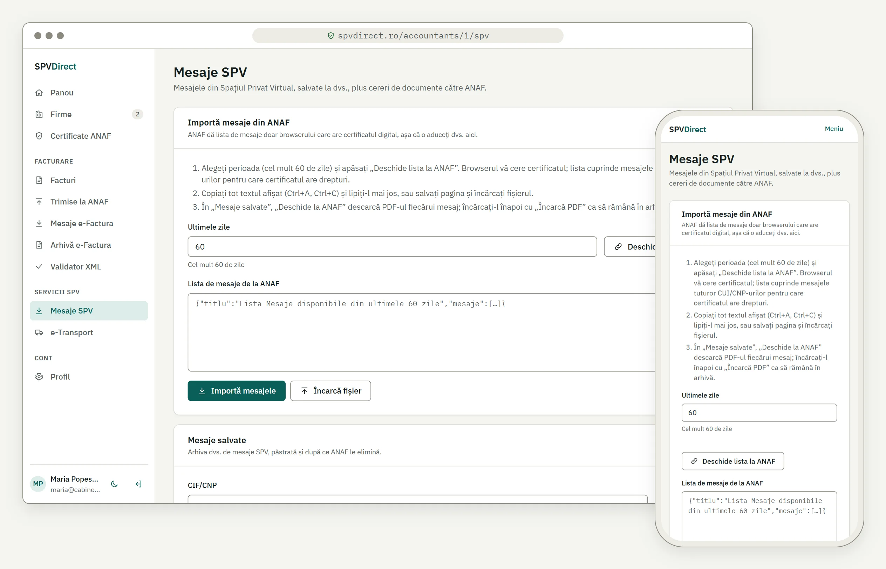
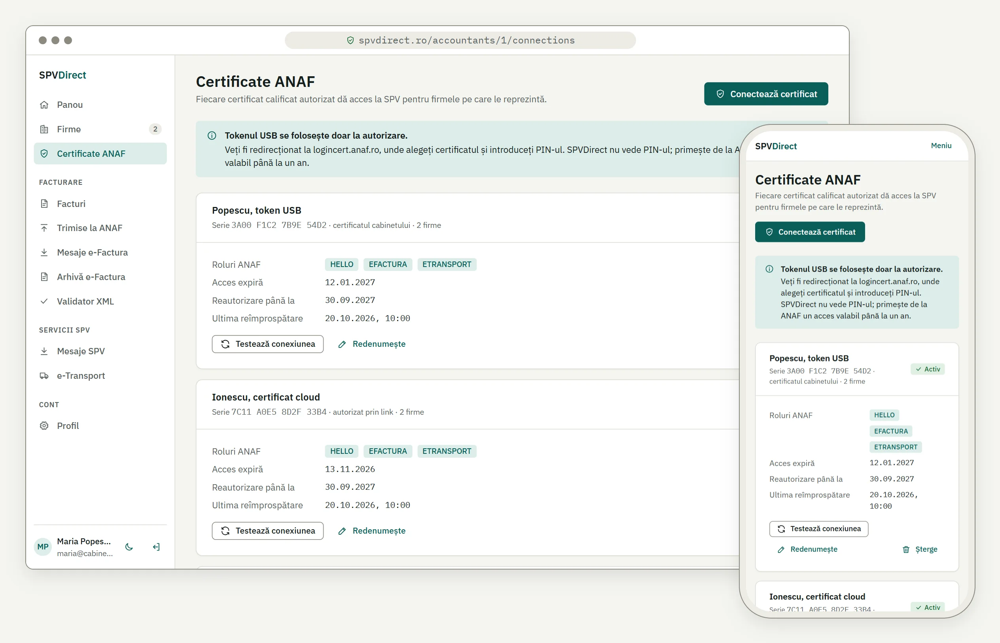

# SPVDirect – ANAF SPV Accountant Portal

**Language:** Romanian UI · **Stack:** NestJS 12 + React + PostgreSQL (Supabase) + TypeORM 1.x · **Author:** Andrei

SPVDirect is an accountant portal for ANAF SPV services: **e-Factura**, **e-Transport** and related tax documents.

<picture>
  <source media="(prefers-color-scheme: dark)" srcset="frontend/public/screenshots/panou-dark.webp">
  
</picture>

```
SPVDirect/
  backend/    NestJS API (this phase)
  frontend/   React app (Vite + React 19, see frontend/README.md)
```

---

## Features

- **Accountant account**: sign up with email and password; an administrator approves each new account before it can be used.
- **Professional profile**: name, phone, CECCAR membership, CCF card and your own practice (filled in from ANAF by CUI).
- **Client companies**: add a company by its CUI, one at a time or up to 500 at once. Name, address, VAT status and CAEN activity come from ANAF automatically and can be refreshed anytime.
- **ANAF certificates**: connect your digital certificate (USB token or cloud) once, then work without plugging it in again. Several certificates per account, each with a name you choose, and a quick connection test.
- **Authorization links**: when a client holds the certificate, send them a one-time link (valid 7 days) so they can authorize SPVDirect for you without sharing the certificate.
- **Invoices (Facturi)**: issue fiscal invoices with automatic numbering per series, VAT calculated by rate and delivery date, buyer data filled in from ANAF, line suggestions from earlier invoices to the same buyer and your company logo. Download them as PDF or as the XML ANAF expects.
- **Storno invoices**: reverse an invoice fully or only some of its lines; the app never lets a line be reversed more than once.
- **e-Factura**: send invoices (or any XML file) to ANAF, follow their status, read ANAF's answer and download the confirmation. Invoices are checked with ANAF's validator before sending, and the same invoice can't be sent twice by mistake.
- **e-Factura messages**: see the invoices received and sent through e-Factura for each client company.
- **e-Factura archive**: keep the invoices from e-Factura after ANAF removes them (ANAF keeps them only 60 days). Search by partner, number or period, see totals, download the original ZIP, the XML or a PDF, and email them. The archive can fill itself three times a week.
- **XML validator and PDF converter**: check any e-Factura XML with ANAF's validator and turn it into a readable PDF.
- **SPV messages archive**: keep the messages from your SPV inbox (notices, certificates, reports) and their PDFs in one place, matched to your client companies.
- **Email and cloud copies**: email any invoice to the client and keep a copy of the PDF in secure cloud storage.
- **Dashboard (Panou)**: monthly and yearly invoicing totals, the last 6 months at a glance, and an activity log of everything done in the account.
- **Export and deletion**: download everything held for a company, or for the whole account, as one ZIP. Deleted data can still be recovered for 30 days before it is erased for good.
- **e-Transport**: coming soon.

### Scheduled jobs

Some work runs on its own, on a fixed schedule (Romania time, Europe/Bucharest). When several servers run the app, only one of them does each job. What a job does for an accountant shows on their Panou, with **Sistem (automat)** as the user: invoices imported into the archive, an import that failed for one of their companies, and how many of their deleted companies were erased (a count only, no names). Each accountant sees only their own entries. The overall summary of each run covers every account, so it is kept for the administrator and never shows on Panou or in exports.

| Job | When | What it does |
|---|---|---|
| e-Factura archive sync (`EfacturaArchiveSyncJob`) | Monday, Wednesday and Friday at 07:00 | Imports the invoices from the last 60 days into **Arhivă e-Factura** for every company that has a certificate, so nothing is lost when ANAF deletes them. Off by default; turn it on with `EFACTURA_ARCHIVE_SYNC=true` |
| Account approval reminder (`AdminApprovalRetryJob`) | Every day at 08:00 | Sends the approve/reject email to the administrator again for sign-up requests whose first email failed |
| Purge of deleted data (`PurgeJob`) | The 1st of every month at 03:00 | Erases for good the companies and accounts deleted more than 30 days ago, with their invoices, e-Factura files, SPV messages and stored PDFs. Any ANAF certificate still connected to a purged account is revoked first |
| SPV inbox sync (`SpvSyncJob`) | Monday, Wednesday and Friday at 03:00 (when enabled) | Would pull SPV messages and their PDFs from ANAF. **Not active:** ANAF does not accept application access to the SPV inbox yet (see `docs/adr/0001-no-spv-inbox-over-oauth.md`), so the job is not registered |

---

## Screenshots

Desktop and mobile views of the main pages, with sample data. Run `npm run screenshots` in `frontend/` to regenerate them from the real app (see `frontend/README.md`).

### Companies (Firme)

Client companies with their ANAF data and the certificate used for each.

<picture>
  <source media="(prefers-color-scheme: dark)" srcset="frontend/public/screenshots/firme-dark.webp">
  
</picture>

### Invoices (Facturi)

Issued invoices with their e-Factura status, PDF, XML and email.

<picture>
  <source media="(prefers-color-scheme: dark)" srcset="frontend/public/screenshots/facturi-dark.webp">
  
</picture>

### e-Factura archive (Arhivă e-Factura)

Received and sent invoices kept after ANAF deletes them.

<picture>
  <source media="(prefers-color-scheme: dark)" srcset="frontend/public/screenshots/arhiva-dark.webp">
  
</picture>

### SPV messages (Mesaje SPV)

Import of the SPV inbox and the saved messages.

<picture>
  <source media="(prefers-color-scheme: dark)" srcset="frontend/public/screenshots/spv-dark.webp">
  
</picture>

### ANAF certificates (Certificate ANAF)

Connected certificates, their roles and expiry dates.

<picture>
  <source media="(prefers-color-scheme: dark)" srcset="frontend/public/screenshots/certificate-dark.webp">
  
</picture>

---

## User guide for accountants

1. **Sign up.** Open **Cont nou** on the home page. An administrator approves your account, then you can log in and fill in **Profil**.
2. **Connect your certificate.** In **Certificate ANAF**, choose to connect, then confirm at ANAF with your USB token or cloud certificate. You only do this once; after that the token isn't needed. If a client holds the certificate, open their company and send them a one-time link (**Generează link**, valid 7 days).
3. **Add companies.** In **Firme**, press **Adaugă** and type the CUI without "RO" (or paste a list). The details come from ANAF. Pick the certificate to use for each company and add the IBAN, contact details and logo for its invoices.
4. **Issue invoices.** In **Facturi**, pick the company and series, type the buyer's CUI (the details are filled in) and add the lines; VAT is calculated for you. Invoices can't be edited or deleted. To correct one, issue a **storno**.
5. **Send to e-Factura.** From an invoice, send it to ANAF; it is checked first. Follow its status and download ANAF's answer in **Trimise la ANAF**.
6. **Keep received invoices.** **Mesaje e-Factura** shows what ANAF holds for the last 60 days. Import them into **Arhivă e-Factura** to keep them after ANAF deletes them.
7. **SPV messages.** In **Mesaje SPV**, follow the steps on the page: open your message list at ANAF, then paste or upload it here, along with each PDF.
8. **Export and delete.** **Descarcă arhiva firmei** downloads everything about a company. Keep it, because invoices must be kept for 10 years. Deleted data is erased for good after 30 days.

Your certificate and PIN are only ever used on ANAF's own login page. Everything done in the account appears in the activity log on **Panou**.

---


## API (Phase 1)

| Method | Path | Auth | Purpose |
|---|---|---|---|
| GET | `/health` | none | Liveness |
| GET | `/public/stats` | none | Landing-page counters: active accountants, companies, invoices, invoices accepted in e-Factura, SPV messages, ANAF certificates. Aggregates only, 30 requests/min per IP. Cached on the server until a counted table changes (5 min at most); browsers must revalidate (`no-cache`) |
| POST | `/auth/register` | none | Request an account (reCAPTCHA v3 `captchaToken`). Answers 202; the account stays pending and `ADMIN_EMAIL` gets approve/reject links |
| GET · POST | `/auth/registrations/:token/approve` · `/reject` | link | Admin links from the email. GET shows a confirmation page, POST acts. Reject deletes the request and adds the email to `banned_emails` |
| POST | `/auth/login` | none | Log in (sets cookie). 403 while the account is pending |
| POST | `/auth/logout` | none | Clear cookie |
| GET | `/auth/me` | session | Current accountant |
| GET/PATCH | `/accountants/:accountantId/profile` | session | Read / update name, phone, CECCAR membership (title, card number, branch), CCF card number, practice name, CUI and CAEN code (response includes the CAEN name) |
| GET | `/accountants/:accountantId/profile/firm-lookup/:cui` | session | Read the practice's name and CAEN code from ANAF's VAT registry (nothing is saved) |
| GET | `/caen/:code` | session | CAEN class name (Rev. 3 first, Rev. 2 fallback), 404 if unknown |
| POST | `/accountants/:accountantId/password` | session | Change password (needs the current one; 400 if it is wrong). Ends every other session and re-issues the cookie |
| GET | `/accountants/:accountantId/export` | session | ZIP of the whole account: profile, ANAF certificates (no tokens), companies list, the activity log (`activitate.csv`), a `firme/<cui>/` folder per company (same content as the company export) and SPV messages that match no company. 5 requests/min |
| GET | `/accountants/:accountantId/activity?companyId=&action=&page=&pageSize=` | session | Activity log shown on Panou, newest first: every operation done in the app (login, profile and password, companies created, edited, exported or deleted, invoices issued, stornoed, emailed or stored, e-Factura uploads, status checks, downloads, message lists, validations and XML to PDF, SPV imports and PDFs, certificates connected, renamed, tested or removed, authorization links). Rows live in `api_logs` (`service` `ACTIVITY`, the action in `endpoint`, plus `description` and `details`); `accountantName` is joined from `accountants`. Page size 20 by default, at most 100 |
| DELETE | `/accountants/:accountantId` | session | Delete the account: body `{ "password" }` (400 if wrong). Soft delete of the account, its companies and all their data; ANAF certificates are revoked and removed; the session cookie is cleared and every other session ends. 409 while an invoice is being sent to ANAF. The email can register again right away; `PurgeJob` erases the data 30 days later |
| GET/POST | `/accountants/:accountantId/companies` | session | List / add client company by CUI (without RO); name and details come from ANAF's VAT registry, 400 if the CUI is unknown. Company responses include `caen` (the CAEN code's name) |
| POST | `/accountants/:accountantId/companies/bulk` | session | Add up to 500 companies at once: `{ "cuis": [...] }`. ANAF is queried in batches of 100; returns one `{ cui, status: created, exists or not_found, company? }` per unique CUI |
| POST | `/accountants/:accountantId/companies/:id/anaf-refresh` | session | Re-read the company's data from ANAF's VAT registry |
| GET/PATCH/DELETE | `/accountants/:accountantId/companies/:id` | session | Read / update (name, certificate, and the IBAN, bank, email and phone printed on invoices) / delete. Delete is a soft delete: the company, its invoices, e-Factura uploads and SPV messages get `deleted_at` and disappear everywhere; 409 while an invoice is being sent to ANAF. `PurgeJob` erases them, with their Storage files, on the 1st of the month once they have been deleted for 30 days |
| GET | `/accountants/:accountantId/companies/:id/export` | session | ZIP of everything held for the company (company JSON and logo, invoices as CSV/JSON plus each PDF and UBL XML, e-Factura uploads CSV, SPV messages CSV plus stored PDFs, `erori.txt` for files that could not be read). The company page always offers it ("Descarcă arhiva firmei") and asks for it again before a delete, since invoices must be kept 10 years. 5 requests/min |
| PUT/GET/DELETE | `/accountants/:accountantId/companies/:id/logo` | session | Company logo for invoices: multipart field `logo`, PNG or JPEG up to 512 KB (checked by file signature). Company responses carry `hasLogo` |
| POST | `/accountants/:accountantId/companies/:id/authorization-links` | session | One-time link for the certificate holder |
| GET | `/accountants/:accountantId/anaf/connect` | session | Start OAuth with your own certificate |
| GET | `/anaf/authorize/:token` | link | Landing page for authorization links (a malformed token answers 400 before any lookup) |
| GET | `/anaf/authorize/:token/start` | link | Sets the state cookie and redirects the certificate holder to logincert.anaf.ro |
| GET | `/anaf/callback` | state cookie | ANAF redirect target. The `state` query parameter is required and must match the cookie. For a link, the link is claimed before any token is stored |
| GET | `/accountants/:accountantId/anaf/connections` | session | List certificates (no tokens returned) |
| PATCH/DELETE | `/accountants/:accountantId/anaf/connections/:id` | session | Rename / remove (remove revokes both tokens at ANAF, 10 requests/min) |
| GET | `/accountants/:accountantId/anaf/connections/:id/test` | session | Call ANAF TestOauth `hello` (10 requests/min) |
| GET | `/accountants/:accountantId/anaf/connections/:id/spv/messages?zile=&cif=` | session | SPV `listaMesaje`: messages from the last 1–60 days, optionally for one CIF/CNP. **Not usable:** SPVWS2 does not accept ANAF OAuth tokens and answers 502 (see docs/adr/0001-no-spv-inbox-over-oauth.md) |
| GET | `/accountants/:accountantId/anaf/connections/:id/spv/messages/:messageId/download` | session | SPV `descarcare`: the message PDF (id from the list). **Not usable:** SPVWS2 does not accept ANAF OAuth tokens and answers 502 (see docs/adr/0001-no-spv-inbox-over-oauth.md) |
| POST | `/accountants/:accountantId/anaf/connections/:id/spv/sync` | session | Pull the last `zile` (default 60) days of SPV messages from ANAF into the `spv_messages` table and save each PDF. Returns `{ fetched, added, downloaded, failed, pending }`; at most 100 PDFs per run. **Not usable:** SPVWS2 does not accept ANAF OAuth tokens and answers 502 (see docs/adr/0001-no-spv-inbox-over-oauth.md) |
| GET | `/accountants/:accountantId/spv/archive?cif=&type=&companyId=&page=&pageSize=` | session | Saved messages (metadata and whether the PDF is stored), newest first |
| GET | `/accountants/:accountantId/spv/archive/:id/download` | session | Saved PDF; 409 when it was never saved (open it at ANAF and upload it, see below) |
| POST | `/accountants/:accountantId/spv/archive/import` | session | Import the message list the accountant opened in the browser at `webserviced.anaf.ro/SPVWS2/rest/listaMesaje?zile=N` with their certificate. Multipart field `file` (the JSON, up to 5 MB and 10000 messages); messages already saved are skipped, each is matched to a company by CIF. Returns `{ fetched, added }`. 60 requests/min |
| PUT | `/accountants/:accountantId/spv/archive/:id/document` | session | Save the PDF the accountant downloaded from `descarcare?id=<anafMessageId>` on that message. Multipart field `document` (PDF, up to 10 MB). Stored like a synced PDF (database or Supabase Storage). 60 requests/min |
| GET | `/accountants/:accountantId/invoices?companyId=&page=&pageSize=` | session | Issued invoices, newest first (summary rows) |
| GET | `/accountants/:accountantId/invoices/buyer-lookup/:cui` | session | Buyer data from ANAF's VAT registry (name, address, reg. com., IBAN, VAT status) to prefill the invoice |
| GET | `/accountants/:accountantId/invoices/buyers/:cui` | session | Buyer for the editor: the buyer of the accountant's latest invoice to that CUI (with VAT, inactive and e-Factura status refreshed from ANAF, best-effort), else the accountant's own company with that CUI, else ANAF. `source` says which |
| GET | `/accountants/:accountantId/invoices/line-suggestions?companyId=&buyerCui=` | session | Distinct lines (latest wins, per currency) from the last 50 invoices of that company to that buyer |
| GET | `/accountants/:accountantId/invoices/next-number?companyId=&series=` | session | Next free number in a series |
| POST | `/accountants/:accountantId/invoices` | session | Issue an invoice for one of the accountant's companies. Optional `saveToStorage` (PDF to Supabase Storage) and `sendToEmail` (PDF attached). Answers `{ invoice, storageError, emailError }`: a failed follow-up never undoes the invoice |
| GET | `/accountants/:accountantId/invoices/:id` | session | Full invoice (seller and buyer as issued, lines, VAT breakdown, totals) |
| GET | `/accountants/:accountantId/invoices/:id/pdf` · `/xml` | session | PDF (the stored copy when there is one) / UBL 2.1 CIUS-RO XML |
| POST | `/accountants/:accountantId/efactura/invoices/:invoiceId/upload` | session | Send an issued invoice to ANAF (UBL). The XML is checked first with ANAF's validator (400 with `errors` when it fails; skipped when the validator is down). 409 when the invoice is already `sending`, `processing` or `ok` at ANAF: the upload is claimed with a `sending` row (unique per invoice) before anything is sent, so two clicks cannot file it twice. Returns the upload record with the ANAF `uploadIndex` |
| GET | `/accountants/:accountantId/efactura/invoices/latest-uploads?ids=1,2,3` | session | The newest upload of each listed invoice (at most 100 ids), for the ANAF column of the invoice list |
| POST | `/accountants/:accountantId/efactura/uploads` | session | Send an XML file (multipart `file`, max 10 MB) for a company: `companyId`, `standard` (UBL, CN, CII, RASP), optional `extern`, `autofactura`, `executare`, `b2c` (uses `uploadb2c`) |
| GET | `/accountants/:accountantId/efactura/uploads` | session | Uploads of the accountant, newest first. Query: `companyId`, `invoiceId`, `page`, `pageSize` |
| GET | `/accountants/:accountantId/efactura/uploads/:id` | session | One upload |
| POST | `/accountants/:accountantId/efactura/uploads/:id/refresh` | session | Ask ANAF for the state (`stareMesaj`): `processing`, `ok`, `nok` or `rejected`. A final state is returned without calling ANAF again (limit: 100 queries per message per day) |
| GET | `/accountants/:accountantId/efactura/uploads/:id/download` | session | ANAF's answer as a zip (`descarcare`; limit: 10 downloads per message per day) |
| GET | `/accountants/:accountantId/efactura/companies/:companyId/messages` | session | Messages from ANAF with the company certificate. Query: `zile` (1–60, default 30), `filtru` (E errors, P received, T sent, R buyer message), or `startTime` + `endTime` (Unix ms) + `pagina` for the paginated list. ANAF's "Nu exista mesaje" is an empty list. Each message has `archivedId` when it is already in the e-Factura archive |
| POST | `/accountants/:accountantId/efactura/companies/:companyId/messages/import` | session | Import up to 50 messages (`{ messageIds }`) into the e-Factura archive: each is downloaded once, its invoice XML is read (UBL, credit note or CII) and the signed ZIP is stored. Per message: `imported`, `already`, `skipped` (not an invoice, or the company is neither supplier nor buyer) or `failed` with a reason |
| POST | `/accountants/:accountantId/efactura/companies/:companyId/messages/import-period` | session | Import the invoices (FACTURA PRIMITA / TRIMISA) of the last `zile` days (1–60), at most 50 per call. Returns `{ found, remaining, results }`; call again while `remaining > 0` |
| GET | `/accountants/:accountantId/efactura/archive` | session | Archived invoices. Query: `direction` (`received` / `sent`), `companyId`, `from`/`to` (issue date), `q` (number, partner or CUI), `page`, `pageSize`. Returns `{ items, total, page, pageSize, totals }` (sum per currency, credit notes negative) |
| GET | `/accountants/:accountantId/efactura/archive/:id` | session | One archived invoice with its lines |
| GET | `/accountants/:accountantId/efactura/archive/:id/{zip,xml,pdf}` | session | The original ZIP from ANAF, the invoice XML from it, or a PDF made once by ANAF's converter (no validation) and cached. CII has no PDF (400) |
| POST | `/accountants/:accountantId/efactura/archive/:id/email` | session | Email the archived invoice (`{ to, message? }`) with the PDF and the original ZIP |
| GET | `/accountants/:accountantId/efactura/companies/:companyId/messages/:messageId/download` | session | Download a message (an invoice received, or an error report) as a zip |
| POST | `/accountants/:accountantId/efactura/validate` | session | Validate an XML with ANAF's public validator (multipart `file`, optional `standard` FACT1 or FCN). Returns `{ valid, messages, traceId }` |
| POST | `/accountants/:accountantId/efactura/invoices/:invoiceId/validate` | session | Same, for the XML of an issued invoice |
| POST | `/accountants/:accountantId/efactura/transform` | session | XML to PDF with ANAF's public converter (multipart `file`, `standard`, `skipValidation`) |
| GET | `/accountants/:accountantId/invoices/stats` | session | Dashboard statistics in RON: this month, previous month and year to date (invoices, stornos, net, VAT, gross; stornos net against invoices) and the last 6 months |
| POST | `/accountants/:accountantId/invoices/:id/storno` | session | Issue a storno invoice (negative quantities and amounts, referencing the original). Body, all optional: `issueDate`, `series`, `notes`, `lines: [{ lineIndex, quantity }]` for a partial storno (default: everything still left), `saveToStorage`, `sendToEmail`. 409 when nothing is left to reverse or a line would be reversed past its quantity; a storno cannot be stornoed. `GET /invoices/:id` returns `remainingQuantities` per line |
| POST | `/accountants/:accountantId/invoices/:id/store` | session | Save the PDF to Supabase Storage |
| POST | `/accountants/:accountantId/invoices/:id/send` | session | Email the PDF: `{ "to"?: "..." }`, defaults to the buyer's email |
| POST | `/accountants/:accountantId/anaf/connections/:id/spv/requests` | session | SPV `cerere`: request a document or report. Body `{ tip, cui, an?, luna?, motiv?, numarInregistrare?, cuiPunctDeLucru? }`; `tip` must be one of ANAF's request types and `motiv` one of its income-certificate reasons, spelled exactly as in MfpAnaf/ClientSPV (`src/anaf/spv/dto/spv-request-types.ts`), otherwise 400; returns `requestId`, which later appears as `requestId` on a message in the list. **Not usable:** SPVWS2 does not accept ANAF OAuth tokens and answers 502 (see docs/adr/0001-no-spv-inbox-over-oauth.md) |

`AnafApiService.request()` is the single gateway to api.anaf.ro. It handles ownership checks, proactive refresh, retry after a refresh on 401/403, 429 mapping and `api_logs` auditing. The e-Factura module (`src/efactura/`) is built on it; e-Transport will be too.

---

## Database schema

The schema is managed by TypeORM migrations in `backend/src/database/migrations`. `synchronize` is off.

| Table | Purpose |
|---|---|
| `accountants` | SPVDirect users (integer id from 1, email is citext and unique among live accounts, scrypt password hash) and their professional profile (CECCAR membership, CCF, practice). `deleted_at` and `status = 'deleted'` mark a deleted account until the monthly purge |
| `anaf_connections` | One per authorized certificate per accountant (unique on `accountant_id` + `cert_serial`): encrypted tokens, `cert_serial`, `roles`, expiries, status |
| `companies` | Client CUIs per accountant (integer id from 1), the connection used for each, and ANAF VAT-registry data (typed columns + full record in `anaf_data` jsonb). `deleted_at` marks a deleted company; the CUI is unique among live rows only, so it can be added again |
| `authorization_links` | Delegated-authorization links (only the SHA-256 of the token is stored) |
| `spv_messages` | SPV messages kept per accountant (unique on ANAF message id), PDF in a `bytea` column (`SPV_STORAGE=database`, default) or in a private Supabase Storage bucket (`SPV_STORAGE=supabase`, path kept in `storage_path`), matched to a company by CIF. Only messages saved before SPV was turned off are here: the nightly sync job (`SpvSyncJob`, which also moved PDFs from the database to Supabase Storage) is not registered, because SPVWS2 does not accept ANAF OAuth tokens (docs/adr/0001-no-spv-inbox-over-oauth.md) |
| `invoices` | Issued invoices, unique on company + series + number. Seller and buyer are stored as they were on the issue date (jsonb), with lines, VAT breakdown and totals; `storage_path` points to the PDF in the private bucket `SUPABASE_INVOICE_BUCKET` when the user chose to save it; `emailed_to` / `emailed_at` record the last send. A storno invoice points to the invoice it reverses (`storno_of_*`). Rows of a deleted company carry `deleted_at` until the monthly purge |
| `efactura_invoices` | The e-Factura archive: one row per imported ANAF message (unique per company, environment and message among live rows), direction `received`/`sent`, the header read from the XML, the signed ZIP and the cached PDF (bytea or Supabase Storage, `EFACTURA_STORAGE`), `invoice_id` when it is one of our own uploads |
| `efactura_uploads` | One row per upload to ANAF e-Factura: index, environment it was sent to, status (`sending` while the request is in flight, then `processing`, `ok`, `nok` or `rejected`), download id. A partial unique index allows one `sending`/`processing`/`ok` upload per invoice; a `sending` row older than 5 minutes is treated as an interrupted send and can be taken over |
| `api_logs` | Audit of every api.anaf.ro call, every VAT-registry lookup (service, endpoint, status, latency) and every email SPVDirect sends: admin approval requests, account approval notices, invoices and archived e-Factura invoices (`service` `SMTP`, with the recipient, subject, attachment names and SMTP reply code, never the body). Also holds the activity log shown on Panou, and SQL queries slower than `DB_SLOW_QUERY_MS` (`service` `DB`, query text without parameters). Every row is also written to the app log (Winston, context `ApiLog`, JSON on stdout in production for CloudWatch Logs; `LOG_LEVEL` sets the level) |

---

## Getting started

### Prerequisites
- Node **24 LTS** (`.nvmrc`). Node 26 becomes LTS in Oct 2026, so there's no need to upgrade yet.
- A Supabase project (free tier is fine).
- An ANAF developer registration: anaf.ro → Servicii Online → Înregistrare utilizatori → **Dezvoltatori aplicații**. Then in SPV → **Editare profil Oauth**:
  - Add an application with the services E-Factura and E-Transport.
  - Set **Callback URL** to `https://localhost:3000/anaf/callback` (it must match `ANAF_REDIRECT_URI` exactly). Add the production URL later as Callback URL 2.
  - Copy the Client ID and Client Secret.

### Setup
```bash
cd backend
npm install
cp .env.example .env        # fill in DATABASE_URL, secrets, ANAF credentials
npm run migration:run       # creates the 6 tables in Supabase
npm run cert:dev            # self-signed cert for https://localhost (certs/, git-ignored)
npm run dev                 # https://localhost:3000
```

### Useful commands
```bash
npm test                    # unit tests (vitest)
npm run test:e2e            # HTTP smoke test
npm run lint                # oxlint (type-aware)
npm run migration:show      # applied/pending migrations
npm run migration:generate -- src/database/migrations/<Name>   # after entity changes
```
After generating or creating a migration, add its class to `src/database/migrations/index.ts`.

`src/open-data/` reads public datasets from data.gov.ro (licence OGL-ROU-1.0) through its CKAN API (`DATA_GOV_RO_API_URL`). Nothing is bundled:
- **CAEN names:** the first time one is needed, `CaenService` downloads the latest ONRC `N_CAEN.CSV` and keeps the Rev. 2 and Rev. 3 classes in memory for 24 hours. If data.gov.ro is unreachable, it keeps the last copy and retries after 5 minutes. Without any copy, company pages load without CAEN names, and `/caen/:code` and saving a profile CAEN code answer 503.

### Manual end-to-end check
```bash
curl -k -c jar -H "Content-Type: application/json" \
  -d '{"email":"andrei@example.com","password":"a-long-password"}' \
  https://localhost:3000/auth/login
curl -k -b jar https://localhost:3000/auth/me
```
Register from the React app (the **Cont nou** tab on the landing page, `/?auth=register`), since it needs a reCAPTCHA token, then approve the account from the email sent to `ADMIN_EMAIL`.
Then open `https://localhost:3000/accountants/<your id>/anaf/connect` in the browser where you're logged in (the id is in the `/auth/me` response; accept the self-signed certificate warning once), pick the certificate, and call `GET /accountants/<your id>/anaf/connections/:id/test`. You should see a response starting with `Hello, SPVDirect`.

---

## Roadmap

- [x] Phase 1: backend scaffold, accounts, ANAF OAuth (self + authorization links), schema
- [x] Phase 2, e-Factura: upload, stareMesaj, listaMesajeFactura (plain and paginated), descarcare, validation and XML to PDF. Not done: ANAF's signature validation service.
- [x] Phase 3: React frontend. Done: Login, Dashboard, Companies, Connections. Invoices (Facturi): issue fiscal invoices as PDF and CIUS-RO XML. e-Factura: send invoices and XML files, state, messages, validator. Still to do: e-Transport.
- [ ] Phase 4, e-Transport module
- [ ] Phase 5: AWS deployment, CI/CD

## References
- ANAF OAuth procedure: `Oauth_procedura_inregistrare_aplicatii_portal_ANAF.pdf` (anaf.ro → Dezvoltatori aplicații → Instrucțiuni de utilizare)
- e-Factura technical info: https://mfinante.gov.ro/ro/web/efactura/informatii-tehnice
- e-Transport technical info: https://mfinante.gov.ro/ro/web/etransport/informatii-tehnice
- ANAF support: Formular de contact → "Asistență tehnică servicii informatice" → "OAUTH"
